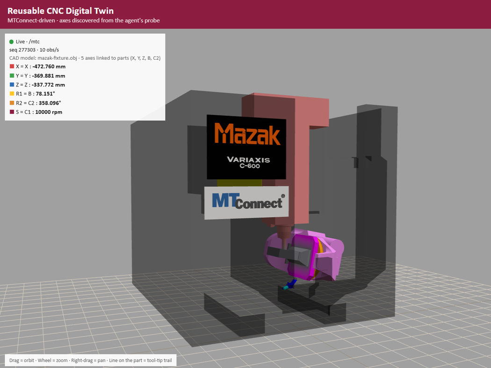
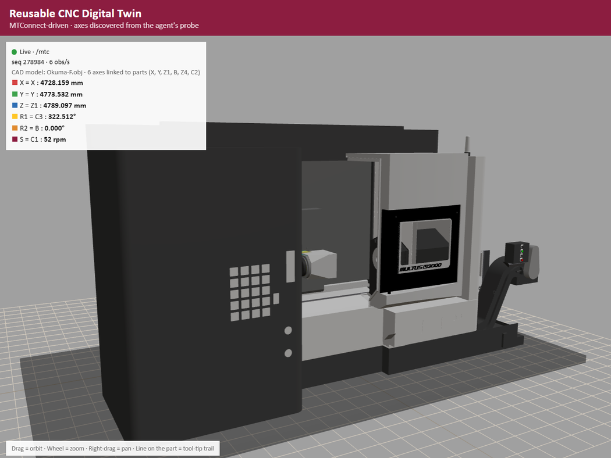

# digital_twin_diego

Digital Twin OKUMA and MAZAK, MFG 598 Industrial IoT (ASU)

This is our digital twin for the CNC assignment. The page connects to the Metalogi demo agent (https://demo.metalogi.io), reads the MTConnect data and moves a 3D machine with the real positions.

## Open it online (recommended)

Click this link (you need to be signed in to GitHub):

**https://codespaces.new/diegobethancourth/digital_twin_diego**

1. Click **Create codespace**.
2. Wait about one minute. The server starts by itself.
3. At the bottom, open the **Ports** tab and click the globe icon on port **8000**. The twin opens in a new tab.
4. Choose **Mazak** or **OKUMA** at the top. The first time, the CAD model takes a few seconds to load.

If the **Ports** tab is empty, click **Forward a Port**, type `8000` and press Enter.

### First time and next times

- You create the codespace only **one time**.
- Next times, open the same codespace from **Code → Codespaces** in this repo (or from github.com/codespaces) and click its name. Wait about one minute and the server starts again.
- The twin address stays the same, so you can save it as a bookmark. It looks like `https://<codespace-name>-8000.app.github.dev/?device=Mazak`.
- The bookmark works only while the codespace is running. It stops by itself after 30 minutes without use, so open the codespace first.
- The address is personal: it only works for the person who created the codespace. Each one of us needs our own codespace.
- GitHub deletes a codespace after 30 days without use. Then just create a new one with the link above.

Note: do not type `python serve.py` in the codespace terminal. The server is already running, and a second one gives "port already in use".

A short step-by-step guide with screenshots is in [`docs/Digital_Twin_Team_Guide.docx`](docs/Digital_Twin_Team_Guide.docx).

## Run it on your computer (optional)

You need Python 3.

1. Download the repo (**Code → Download ZIP**) and unzip it.
2. Double-click `start_twin.bat` (Windows), or open a terminal in the folder and type `python serve.py` (`python3 serve.py` on Mac).
3. Open http://localhost:8000/?device=Mazak in the browser.
4. Leave the window open. To stop it, press Ctrl + C.

## Files

- `index.html` is the digital twin page
- `serve.py` is a small Python server that passes the agent data to the page
- `start_twin.bat` starts everything on Windows with a double-click
- `.devcontainer/` is the setup for Codespaces

## Page structure and design (UI)

- **Top bar**: choose the machine (Mazak or OKUMA) and the view.
- **Solid model view**: the CAD model that the agent gives in its probe, the same as in the Metalogi example.
- **Simplified view**: a block model with 3 linear axes, 2 rotary axes and the spindle. It works for any agent, even one without a CAD file.
- **Box on the 3D view**: the live values (positions in mm, angles in degrees, spindle speed).
- **Right panel**: what the page discovered. It shows every axis with its data item, units, coordinate system and live value, and also the coordinate systems of the machine.

## Machine-independent design

We did not write any machine names, data-item ids or axis names in the code. Everything comes from the agent:

- The devices come from `/probe`.
- A **Linear** axis uses its `POSITION` data item, and a **Rotary** axis uses its `ANGLE` data item. We prefer subtype `ACTUAL` and the MACHINE coordinate system.
- A Rotary axis with only `ROTARY_VELOCITY` is treated as a spindle.
- The direction of each axis comes from `Motion/Axis`. The name is used only if the probe has no direction, and the page shows a warning.
- Which axis is mounted on which comes from the `PARENT` / `CHILD` relationships.
- Live values come from `/current`, then `/sample` every 200 ms.

## Connector (serve.py)

The demo agent does not let other websites read its data (no CORS). So the page cannot work alone on GitHub Pages. `serve.py` gets the data from the agent and gives it to the page from the same address, so the browser accepts it. In Codespaces it runs automatically.

## Demo Agents

- **Mazak**: X, Y and Z move the spindle head, B tilts the table and C2 rotates it.
- **OKUMA**: X, Y, Z1, Z4, B and C3, plus spindles C1, C2 and C6.
